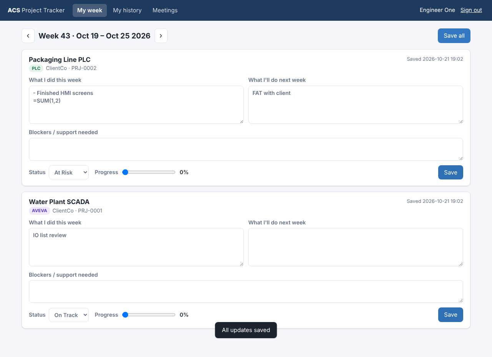

# ACS Project Tracker (acsprojectmanager)

A weekly project-update and minutes-of-meeting tool for the ACS PLC / AVEVA development team.

Each engineer signs in with their **ACS Zoho account**, sees the projects assigned to them, and records:

- what they did this week
- what they plan to do next week
- blockers or support needed, status, and % progress

Everything is stored in a **Google Sheet** on Google Drive. Admins get a weekly report, ready to use as the minutes of the meeting (with copy-as-text and print-to-PDF), and they manage projects, the team and assignments.



## Architecture

```
 Browser (GitHub Pages)                Google Apps Script (web app)          Google Sheet
 ┌───────────────────────┐   HTTPS    ┌────────────────────────────┐        ┌──────────────┐
 │ frontend/  HTML/CSS/JS │ ─────────▶ │ backend/  doPost API        │ ─────▶ │ Projects     │
 │                        │            │  • verifies Zoho token      │        │ Team         │
 │  "Sign in with Zoho"   │            │  • issues signed session    │        │ Assignments  │
 └──────────┬─────────────┘            │  • enforces roles           │        │ WeeklyUpdates│
            │ OAuth (implicit)         └──────────────┬─────────────┘        │ Meetings     │
            ▼                                         │ /oauth/user/info     └──────────────┘
      accounts.zoho.com  ◀────────────────────────────┘
```

- **Login**: users type their password on Zoho's own page, so this app never sees or stores it. The backend checks the Zoho token, requires an `@advcontrolsys.com` email, and requires the person to be listed as Active in the **Team** tab.
- **Roles**: `Member` can edit only their own updates on projects assigned to them. `Admin` can also manage projects, team and assignments, and sees the weekly report.
- **No secrets in this repo**: the session-signing secret is generated in Apps Script and kept in Script Properties.

## Repository layout

| Path | What it is |
|---|---|
| `frontend/` | Static site deployed to GitHub Pages |
| `frontend/js/config.js` | The only file you edit: backend URL and Zoho client ID |
| `backend/` | Google Apps Script source (copy into the Sheet's Apps Script project, or push with `clasp`) |
| `docs/SETUP.md` | Step-by-step setup guide |
| `.github/workflows/pages.yml` | Auto-deploys `frontend/` on every push to `main` |

## Getting started

Follow **[docs/SETUP.md](docs/SETUP.md)**. It takes about 20 minutes:

1. Create the Google Sheet and paste in the Apps Script backend
2. Run `setup()` to create the tabs, then deploy it as a web app
3. Register a Zoho "Client-based Application"
4. Fill in `frontend/js/config.js` and turn on GitHub Pages
