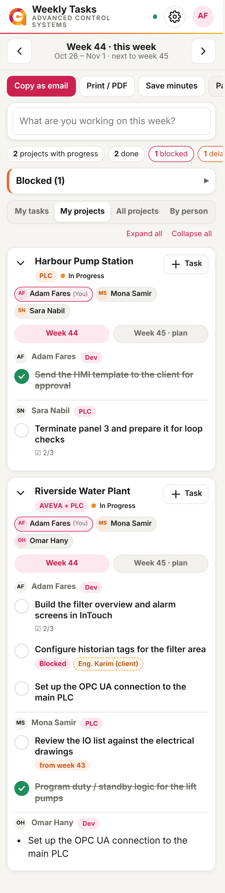
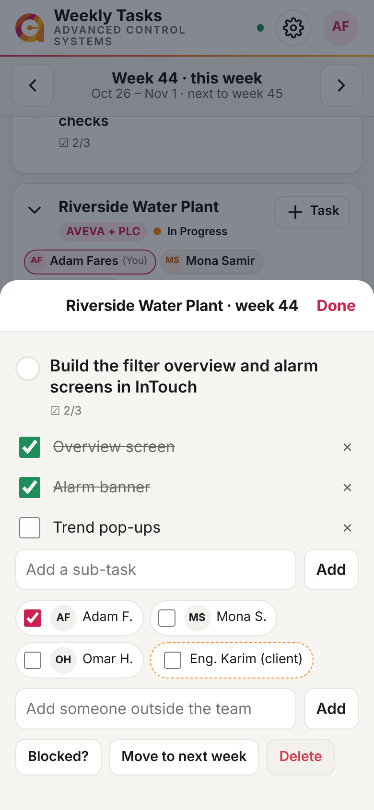
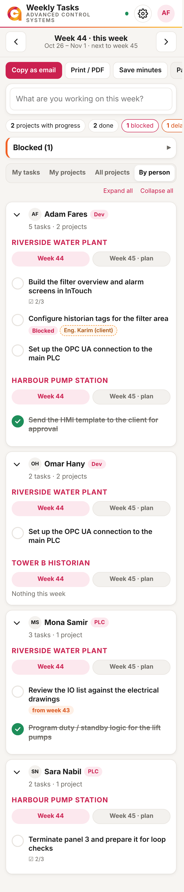
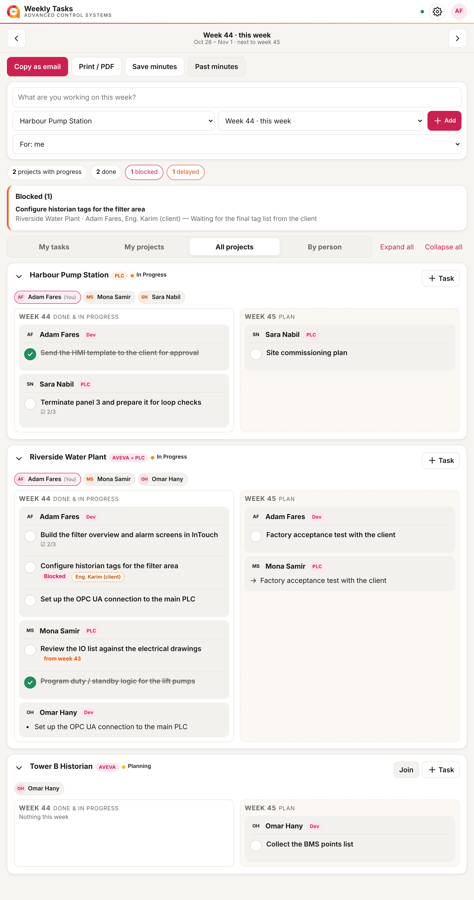

# ACS Project Tracker (acsprojectmanager)

A weekly task tool for the ACS PLC / AVEVA development team. It replaces typing up the weekly meeting by hand.

Each engineer signs in with a **username and password** and:

- sees every project on one board, **this week and next week side by side** (the weekly meeting), and **joins** projects in one tap
- adds **tasks** (with sub-tasks) to **any project** for **last, this or next week**; unfinished tasks roll over automatically
- does everything on **one page**: switch between *My tasks*, *My projects* and *All projects*, tick and edit tasks right on the board
- marks a task **Blocked** with a short note, and can assign teammates or 3rd parties (people without an account)

The board is the meeting: it builds the minutes automatically from everyone's tasks, one card per project, each person's tasks under their name, blocked items first. Admins also get a **By person** view (each employee's tasks, grouped by project), can add tasks for anyone in any week, set who is on each project, and open **Manage** from the ⚙ settings button. **Copy as email** gives the *Weekly Progress Check & Action Plan* table (PLC / Dev columns), and admins can **save the minutes** so that week's record never changes (all saved weeks are under **Past minutes**). Before the meeting, admins see who has **no update yet** and can copy a reminder; from Thursday, everyone gets a nudge to **plan next week**. Changes from teammates appear **live**. Everything is stored in a free **Supabase** database (Postgres); admins manage projects, the team (including each person's PLC / Dev team) and 3rd parties.

| Phone | Task (phone) | By person | Desktop |
|---|---|---|---|
|  |  |  |  |

*(Screenshots use made-up demo data.)*

## Architecture

```
 Browser (GitHub Pages)                         Supabase (free plan)
 ┌────────────────────────┐   HTTPS    ┌────────────────────────────────────────┐
 │ frontend/  HTML/CSS/JS │ ─────────▶ │ Auth: usernames + hashed passwords      │
 │  supabase-js           │            │ Postgres: profiles, projects,           │
 │  no build step         │ ◀───────── │   assignments, tasks, contacts,         │
 └────────────────────────┘  live      │   meetings (saved minutes)              │
                             updates   │ Row Level Security = who can do what    │
                                       └────────────────────────────────────────┘
```

- **No server of our own**: the website talks to Supabase directly. Everything the app needs loads in one request, and the last data is kept on the device so the app opens instantly.
- **Security is enforced in the database** (`supabase/migrations/`):
  - **Members** see every project and can join one. They see and edit the tasks on their projects, and tasks assigned to them. They can't change who created a task or move one into a project they're not on.
  - **Admins** manage projects, the team, assignments, 3rd parties and saved minutes.
  - **Signed-out visitors** see nothing.
  - **New accounts start inactive** unless an admin created them from the app, so a stray sign-up can't see anything.
- **No lost edits**: a save only changes the fields that person changed, and if a teammate saved the same task first, the change is applied on top of theirs.
- **Login**: Supabase Auth with email + password. People type a short username, and `@advcontrolsys.com` is added automatically. Admins create accounts and reset passwords from the **Team** page.
- **The data is easy to view and edit** in Supabase's Table Editor, and can be exported to CSV.

## Repository layout

| Path | What it is |
|---|---|
| `frontend/` | The app: static site deployed to GitHub Pages |
| `frontend/js/config.js` | Supabase Project URL + publishable key (both public by design) |
| `frontend/js/api.js` | Data layer: one-request loading, local cache, conflict-safe saving |
| `frontend/js/app.js` | Screens: My tasks, Projects, Meeting, Manage |
| `frontend/sw.js`, `manifest.webmanifest` | Installable app (Add to Home screen), offline app shell, self-updating |
| `supabase/migrations/` | Every database change, in order ([rules](supabase/migrations/README.md)) |
| `supabase/setup.sql` | All migrations in one file, generated. Paste into the SQL Editor, or let the deploy run it |
| `supabase/import-team.example.sql` | Template for importing the real team and projects (fill it in outside git) |
| `supabase/seed-test-data.sql` | Optional test logins and dummy projects, with a password you choose |
| `tests/db/` | Database tests: security rules and functions, on plain Postgres |
| `tests/e2e/` | Browser tests: the real app in Chromium against a fake Supabase; also makes the screenshots |
| `docs/SETUP.md` | Setup guide, going live, automatic database updates |
| `.github/workflows/ci.yml` | Checks on every branch push: code checks, database tests, browser tests |
| `.github/workflows/pages.yml` | On every push to `main`: checks → database update → publish the website |
| `.github/workflows/keep-alive.yml` | Daily ping so the free Supabase project never pauses |

## Getting started

Follow **[docs/SETUP.md](docs/SETUP.md)**:

1. Paste `supabase/setup.sql` into Supabase's SQL Editor and click **Run**
2. Turn off public sign-up in Supabase Auth settings
3. Add the team with the import template (or test data with `seed-test-data.sql`)
4. Sign in at https://adhamazaki.github.io/acsprojectmanager/
5. Optional: add the `SUPABASE_DB_URL` secret so database changes deploy automatically

This repository is public: never commit passwords or the real team list.

## Development

The app has no build step: edit the files in `frontend/` and open `frontend/index.html` through any local web server. The tools below are only for checks.

```bash
npm ci                                   # ESLint + Playwright (versions pinned)
npx playwright install chromium          # once, for the browser tests
npm test                                 # code checks + setup.sql up to date + browser tests
PGHOST=localhost PGUSER=postgres PGPASSWORD=postgres npm run test:db   # database tests (needs a Postgres server)
npm run screenshots                      # refresh docs/screenshots
```

**Changing the database:** add a new file to `supabase/migrations/` (see the [rules](supabase/migrations/README.md)), run `npm run build:setup`, and add a check to `tests/db/security.test.sql` if it changes who can see or do what.

**Every push** to a branch runs the checks on GitHub. On `main`, nothing is published unless they pass.
